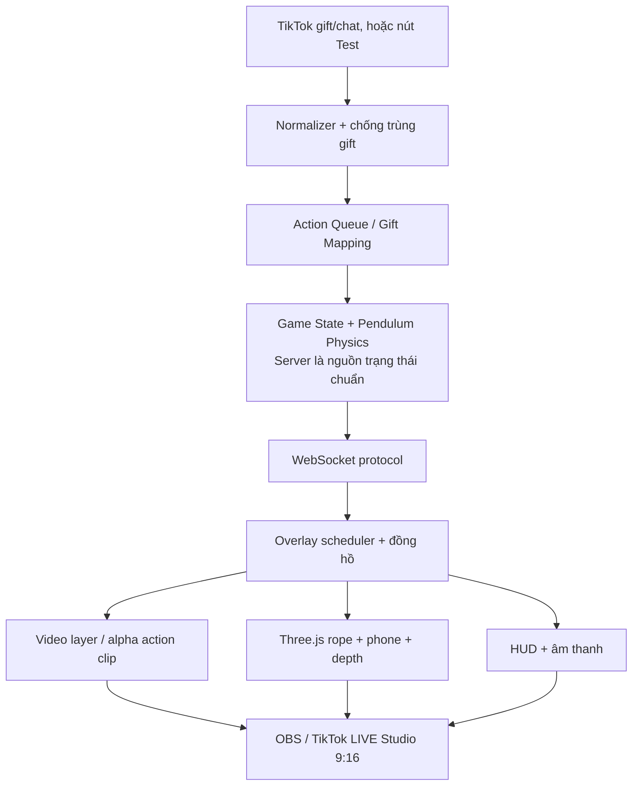

# TIKTOK LIVE ARCADE — HYBRID VIDEO + REAL-TIME 3D
## Đặc tả kỹ thuật / Implementation RFC — v1.1 (03/11/2026)

**Trạng thái:** Đặc tả đã sửa theo review kỹ thuật 03/11/2026; **chưa phải sản phẩm đã được kiểm thử**.  
**Nguồn tham khảo:** [kentjuno/chanh-dien-online](https://github.com/kentjuno/chanh-dien-online), nhánh `main`; MIT License.  
**Phạm vi:** Máy giả lập ảo trên livestream; **không điều khiển thiết bị cơ khí thật, không có iPhone thật bị phá hủy**.  
**Đích:** Windows 11, TikTok LIVE Studio/OBS, overlay dọc 9:16; chạy trên máy phát địa phương; văn bản, UI tiếng Việt.

---

## 0. Cách dùng tài liệu

1. Đọc `TECHNICAL_SPEC.md`, `AGENT_IMPLEMENTATION_PROMPT.md`, `ASSET_MANIFEST.example.json`.
2. Fork/copy repo công khai sang **repo riêng có quyền ghi**; **không chỉnh sửa upstream** trừ khi chủ repo cấp quyền. Giữ LICENSE MIT và attribution.
3. Agent thực hiện **theo cổng nghiệm thu P0 → P1 → P2 → P3**, làm P0 trước rồi mới phát triển đầy đủ; không nhảy thẳng vào sản xuất nhiều video AI.
4. Mọi tham số ghi trong tài liệu là **giá trị khởi tạo để thử nghiệm**, có thể điều chỉnh qua config; không được ngụy tạo dữ liệu benchmark hoặc chứng nhận tương thích.

### Thay đổi từ v1.0 → v1.1 (đọc trước khi code)

1. Tọa độ chạy Three.js chuẩn **+Y lên**, con lắc trong **X–Y**, không dùng công thức mặt phẳng X–Z của bản cũ.
2. Video action cấp cho engine là **clip đã trim thực sự**, bắt đầu từ mốc 0, keyframe đầu clip; **không seek giữa file khi nhận quà**.
3. Bổ sung giao thức `overlay:prepared` → `attack:armed` → `overlay:attack_ack`/`overlay:drift_abort` → `attack:contact`/`attack:aborted` cùng quy tắc commit một lần.
4. Quản trị local: **bootstrap URL token ngẫu nhiên một lần → cookie HttpOnly nội bộ**, kết nối WS `control` chỉ khi session hợp lệ; không cần tài khoản/mật khẩu.
5. Camera được **nhúng trực tiếp trong manifest public dưới tọa độ Three.js Y-up**; file `blender/camera.json` chỉ là tài nguyên biên tập ngoại tuyến.
6. Mọi ngưỡng drift / độ trễ trong tài liệu là **giá trị thử nghiệm**, phải đo trên Chromium/OBS thực tế. ACK sớm không tạo bảo đảm frame tương lai sẽ hiển thị đúng giờ.

## 1. Mục tiêu, trải nghiệm người xem, giới hạn

**Cảnh chính:** Một điện thoại kiểu iPhone treo bằng sợi dây dưới khung kim loại; dưới là máy nghiền giả lập quay; xung quanh là dao, mũi nhọn, cưa, kéo (đều là hình ảnh ảo). Người xem TikTok LIVE tặng quà → hệ thống chọn đạo cụ → đạo cụ vươn đến dây → có thể hụt, chạm rồi làm dây/iPhone dao động mạnh, hoặc cuối cùng dây đứt → điện thoại rơi vào máy nghiền → bắt đầu vòng mới.

**Yêu cầu trải nghiệm bắt buộc:**
- Môi trường/đạo cụ **đẹp như video quay thật** nhờ Blender dựng chuyển động gốc + hậu kỳ AI video.
- Dây và điện thoại **luôn chuyển động liên tục** qua lúc chờ, lúc chịu va chạm, lúc hồi phục. Tuyệt đối không nhảy vị trí/vận tốc khi đổi clip.
- Nhận quà thật hoặc quà giả lập; người xem được ghi nhận ngay, hành động diễn ra theo hàng đợi có thứ tự.
- Một góc camera cố định trong MVP; cùng phối cảnh, ánh sáng, vị trí, kích thước giữa tất cả lớp.
- Hoạt động được khi chưa kết nối TikTok; phát LIVE 9:16 qua OBS Browser Source hoặc cửa sổ trong TikTok LIVE Studio.
- Toàn bộ máy và quà là **mô phỏng**; không gọi đây là giải thưởng thật, không tự ý gắn cờ trúng quà vật lý; không dùng tỷ lệ thắng bí mật để kích thích chi tiêu.

**Ngoài phạm vi MVP:** máy thật/Arduino, remote multiplayer, giao quà vật lý, xử lý thanh toán, random prize bằng tiền, camera chuyển động tự do, VR, realtime generative video, AI suy ra vật lý đúng trong thời gian live.

## 2. Quyết định kiến trúc quan trọng

> **Không phát video dây/điện thoại đã render sẵn khi live.** Video AI chỉ phụ trách phần nền và đạo cụ. Dây + điện thoại được render 3D realtime trên một đồng hồ mô phỏng liên tục. Lớp AI nào không giữ được độ chính xác không gian phải có đường lui dùng Blender PBR.

| Lớp | Trách nhiệm | Giải pháp chính |
|---|---|---|
| L0 | Video môi trường/khung máy/máy nghiền | AI-refined MP4/WebM làm **clean plate**, loop không có dây/điện thoại/đạo cụ |
| L1 | Vùng che khuất + bóng đổ | Occlusion proxy, mặt nạ foreground/depth; màu bóng khớp nền |
| L2 | Dây và điện thoại | Blender `.glb` + Three.js/WebGL; mô phỏng con lắc + sóng dây realtime |
| L3 | Dao, mũi nhọn, cưa | Clip AI-refined với **alpha/mask đã kiểm chứng** trên mặt phẳng đúng camera; fallback đạo cụ `.glb` realtime |
| L4 | Hạt bụi, tia lửa, ánh đèn, chữ/tên | WebGL/HTML/CSS, âm thanh đã cấp phép |

**Trình tự vẽ thực tế:** không đơn giản luôn L0→L4. Renderer phải hỗ trợ đạo cụ đi **trước hoặc sau** dây/điện thoại tùy cảnh. P0 giới hạn đạo cụ cắt ngang **phía trước dây**; ở P2 dùng mask/depth hoặc các lớp tool-back/tool-front. Đạo cụ đang tiếp xúc dây không được bị che bất hợp lý.

**Khuyến nghị renderer:** Một WebGL canvas Three.js chứa video background qua `VideoTexture`, đạo cụ alpha qua video-textured plane hoặc mesh, dây và điện thoại 3D, shadow cards, đồ họa hiệu ứng; HUD đặt bằng DOM phía trước canvas. Có thể thử DOM `<video>` phía sau WebGL transparent canvas nếu thiết bị OBS chạy tốt hơn, nhưng cần benchmark cả hai rồi ghi quyết định.



## 3. Đánh giá repo gốc và chiến lược fork

Đã đọc mã nguồn theo repo public tại thời điểm lập tài liệu:

| File hiện có | Vai trò / quyết định |
|---|---|
| `live/server.mjs` | Giữ HTTP server localhost, TikTok connector, broadcast WebSocket và kiểm tra an toàn; tách gameplay riêng thay vì nhồi thêm logic vào file này |
| `live/overlay.html` | Thay giao diện chánh điện bằng shell game và tải module Three.js |
| `live/control.html` | Giữ kết nối TikTok, nhập username, gửi thử chat/gift, bot; thiết kế lại quản trị máy/game/clip/đạo cụ |
| `live/package.json` | Gốc dùng Node >=20 theo README, `ws` 8.18.0, `msedge-tts` 2.1.1, `tiktok-live-connector` 2.5.0; kiểm thử và khóa phiên bản trước khi thêm `three` |
| `index.html`, `assets/` | Ứng dụng chánh điện tĩnh độc lập; giữ nguyên hoặc để trong `legacy/`, **không xóa trước khi so sánh chức năng** |
| `README.md`, `LICENSE` | Cập nhật hướng dẫn mới, bảo lưu MIT và nguồn gốc |

Nhận xét chính từ code: server nhận `CHAT`, `GIFT`, `MEMBER`, `LIKE`, có xử lý gift streak loại 1 bằng `repeatEnd`, gửi sự kiện qua `/ws`, giới hạn lệnh từ overlay, có giả lập quà; server mặc định ràng buộc `127.0.0.1` và kiểm `Host`/`Origin`. Những lớp bảo vệ này là **baseline** cần giữ hoặc cải thiện. **Không nhận định đã vượt kiểm thử độc lập**.

**Nguyên tắc sửa:** nhánh `feature/hybrid-arcade` riêng, commit nhỏ theo phase, không sửa upstream, không phá các chức năng bảo mật/đọc gift. Nếu agent muốn xóa giao diện cũ, phải ghi danh mục file và lý do, tạo ghi chú migration.

## 4. Hợp đồng Blender → AI video → Engine

### 4.1. Một “cảnh gốc” là nguồn chân lý hình học

- Dựng `master_scene.blend` với **Blender +Z lên**, 1 Blender unit = **1 mét**. **Runtime Three.js dùng +Y lên** và mặt phẳng dao động **X–Y**. Bước xuất Blender → glTF điển hình ánh xạ `(xB, yB, zB) → (xT=xB, yT=zB, zT=−yB)`; phải kiểm tra thực tế với file GLB/empty xuất ra, **không tự xoay 90° thêm lần nữa** nếu importer đã chuyển trục. Các điểm neo/tool/contact và camera đều phải được chuyển về cùng hệ Three.js trước khi xử lý. Không thay scale giữa các clip.
- Một **camera chính cố định**, render 1080×1920 tỷ lệ 9:16, 30 fps, màu/tonemap được chốt theo mẫu. Lưu camera gốc vào `blender/camera.json` phục vụ biên tập; **export chính xác vị trí/hướng/FOV/near/far sau chuyển hệ trục thành object `camera` trong `live/public/asset-manifest.json`** để browser tải một lần. Cả backplate và clip đạo cụ phải trùng camera. Camera JSON gốc không phải đường dẫn cần fetch ở runtime.
- Đặt empties: `ROPE_ANCHOR`, `PHONE_ATTACH`, `GRINDER_OPENING`, `TOOL_CONTACT_LEFT`, `TOOL_CONTACT_RIGHT`, `CAMERA_MAIN`, `OCCLUDER_FRONT`.
- Dây vật lý có anchor trên cao và attach trên phone; điện thoại phải có pivot và tâm khối lượng hợp lý. Phone model chỉ dùng hình dáng tương tự nếu không có quyền sử dụng nhãn/thiết kế thương hiệu.
- Tạo **clean plate** không có dây, điện thoại hay đạo cụ. Nếu AI vô tình tạo bóng ma dây/iPhone trong video nền → **reject**.
- Mỗi đạo cụ có Blender animation thô: xuất `preview.mp4`, `tool_only_rgba` hoặc `tool_mask`, `tool_proxy.glb`, file marker với `contactMs`, `toolId`, quỹ đạo điểm đầu dao và bounds.

### 4.2. Chỉ dẫn AI video

- Input: video thô Blender **cùng camera**, cùng ánh sáng; prompt tập trung vào **chất liệu kim loại, dấu xước, bụi, phản xạ, ánh sáng, rung cơ khí**, không thêm/xóa vật thể hay thay quỹ đạo, góc máy, tốc độ timeline.
- Dùng ảnh tham chiếu style master và frame đầu/cuối (nếu model hỗ trợ) để tăng nhất quán. Giữ cụ thể hình dạng máy nghiền, dây đeo, vị trí công cụ.
- Video Blender/AI **nguồn** dài tối đa khoảng 10–15 giây/clip (phù hợp workflow AI); **đây chỉ là footage sản xuất, không phải file action cấp cho engine**. Trong hậu kỳ, cắt thành video **đã trim 2–4 giây** (MVP nên 1.5–3 giây nếu animation cho phép) và đặt hành động bắt đầu tại **0.0 giây**; marker tiếp xúc thử nghiệm khoảng **600–900ms** từ đầu action. Không giảm thời lượng bằng seek lúc live.
- **Quy trình duyệt:** đối chiếu video AI với render Blender tại các mốc đầu, contact, cuối; đo sai lệch đầu dao tại contact. Nếu AI biến dạng/hallucinate dao vượt ngưỡng thì dùng video Blender đã render photoreal, không “cố” dùng AI.
- Đừng dùng AI để tự quyết định va chạm hoặc chuyển động dây. Động học dây/điện thoại đến từ engine.

### 4.3. Xuất asset, frame và alpha

- Backplate: video không có alpha, 30fps **constant frame rate**, sRGB/Rec.709 theo pipeline; 1080×1920 (có preset 720×1280). Nếu loop 10s thì răng nghiền và ánh sáng nền phải nối vòng tự nhiên.
- **Action clip cấp cho engine: bắt buộc trim ra file riêng với timeline `0.0s`, `activeStartMs: 0`, `contactMs` khởi tạo khoảng `600..900`, `durationMs` thường `1500..4000` theo clip thật.** Ép keyframe đầu tiên tại t=0, CFR 30fps, timebase/PTS bắt đầu 0; kiểm tra bằng `ffprobe` (first video packet/keyframe, duration, FPS). Giữ clip nguồn 10–15s ở thư mục sản xuất, không dùng để phát action trực tiếp. Khi nhận quà, phát file đã preload từ đầu thay vì seek tới 3s. Việc reset video về 0 giữa các lượt chỉ làm khi clip đã kết thúc và đã được đưa về pool, **không dùng runtime seek đến các marker giữa clip**.
- Action clip: ưu tiên alpha đã mask/roto + được xem trên nền ca-rô; nếu xuất WebM VP8/VP9 alpha, phải kiểm thử codec thực tế trong OBS Browser Source. Không mặc định mp4 H.264 có alpha. Có thể lưu thêm bản video RGB + grayscale mask riêng để composite theo shader nếu kênh alpha không ổn.
- `contactMs` là thời điểm đầu dao/cưa **có vị trí gần nhất với vùng dây trên file đã trim, tính từ t=0**; không đặt marker theo cảm giác. `activeStartMs` cố định **0**, `activeEndMs <= durationMs`; `retractEndMs`, `contactWorld`, `contactScreen` đều áp dụng cho **clip runtime**. Marker của footage nguồn được lưu riêng trong metadata authoring và không gửi sang client làm thời gian phát.
- Camera, ánh sáng, noise, grain, DOF và color grading phải đồng nhất. Chỉ camera output mới được thêm shake toàn cảnh sau khi composite; không shake một clip độc lập trong MVP.
- Không dùng crossfade kéo dài trên lưỡi dao/chuyển động mạnh (trông như có hai dao). Dùng animation in/out có vị trí nghỉ ngoài hình hoặc retime theo marker.
- Tạo automated asset validator: kiểm metadata, frame rate, tỷ lệ 9:16, độ dài, manifest và codec; đối với video alpha, kiểm thử thật trên Chromium của OBS.

### 4.4. Cấu trúc asset hợp đồng

Mỗi action có `id`, `toolId`, `src`, `maskSrc` (tùy chọn), `fps`, `durationMs`, `contactMs`, `startMs/endMs`, `cameraId`, `contactPointWorld`, `contactPointScreen`, `depthMode`, `hitVariant`, `checksum` (sau khi xuất); tham khảo `ASSET_MANIFEST.example.json`. Tên file ví dụ là **placeholder**, không giả định đã tồn tại.

## 5. Vật lý dây & điện thoại: giải quyết tính liên tục

### 5.1. Phân biệt 2 chuyển động

**A. Dao động nền (`idle`)** có nhịp thấp, biên độ nhỏ, luôn tồn tại.  
**B. Dao động dư (`disturbance`)** do tác động mới gây ra, có vận tốc và tắt dần.  

Góc hiển thị: `θ_display(t) = θ_idle(t) + δθ(t)`.

Ví dụ cấu hình khởi tạo **cần đo bằng mắt/kiểm nghiệm**, không phải chân lý vật lý:
- Dây dài `L = 0.65 m`, biên độ nền `A = 1.5°`, chu kỳ idle khoảng `2.0 s`, không quay nhiều trục ở P0.
- Nền `θ_idle = A sin(ω_idle t + φ)`; dùng đồng hồ chung và seed chung.
- Dao động dư: `δθ'' + 2 ζ ω_n δθ' + ω_n² δθ = 0`, `ω_n ≈ sqrt(g/L)`; `ζ ≈ 0.12..0.3` để dao động mạnh tắt dần.
- Va chạm bằng cách thay đổi **vận tốc dư** tại một thời điểm: `δθ'_new = δθ'_old + signedImpulse` (đơn vị rad/s; định nghĩa chuyển đổi từ `impulse` của game). Không teleport phone tới góc mới.
- **Công thức runtime Three.js (+Y-up, dao động ngang trong X–Y):** `xPhone = xAnchor + L*sin(θ)`; `yPhone = yAnchor - L*cos(θ)`; `zPhone = zAnchor` (P0 không dao động theo chiều sâu). `(xAnchor, yAnchor, zAnchor)` là điểm neo **sau khi convert Blender → Three.js**. Tuyệt đối **không** dùng `zAnchor - L*cos(θ)` làm trục đứng trong code Three.js. Nếu render offset theo `PHONE_ATTACH`, trừ offset local đúng hệ tọa độ đã xuất.

**Kỹ thuật bắt buộc:** tích phân fixed-timestep (gợi ý 1/120 s), dùng thời gian mô phỏng tăng đơn điệu; renderer nội suy giữa state `previous`/`current`. Giới hạn catch-up sau tab bị treo; khi tab quay lại, resync theo snapshot server **có blend mượt hoặc snap tại cảnh reset**, không tăng vọt lực. Dùng seed để replay và test.

### 5.2. Hiệu ứng dây thật, không chỉ xoay điện thoại

- Dây là mesh/chain có 12–32 đốt hoặc spline có cập nhật vertex/bone; đầu trên cố định, đầu dưới bám vào `PHONE_ATTACH`.
- Khi công cụ chạm gần giữa dây, thêm một **mode biến dạng cục bộ** vào đường dây `w(s,t)` với biên độ tắt dần; truyền phản ứng tới phone (impulse) đúng thời điểm, không làm dây gãy góc không thật.
- Dây phải giữ chiều dài tương đối ổn định, không xuyên phone, không “đứt” ở trạng thái hit-nonbreak.
- Điện thoại có quán tính xoay nhỏ theo hướng chuyển động; không để các nút camera/đèn/đạo cụ tạo bóng không nhất quán.
- Điều khiển `ropeDamage`/`wear` **riêng** với dao động. Damage thay đổi hình ảnh xơ/sờn tại vùng tiếp xúc, **không đổi góc trực tiếp**.

### 5.3. Hồi phục sau va chạm

Không có video `recovery.mp4`. Sau event va chạm, `δθ` và `δθ'` tự suy giảm; `θ_idle` chạy tiếp ở cùng pha. Khi sai lệch đã rất nhỏ, có thể làm mờ phần dư trong 200–500ms; **không reset sang `θ=0` và không khởi động lại loop**. Người xem tặng quà lúc dây còn rung → cộng thêm impulse mới lên chính state đó.

### 5.4. Cắt dây và rơi điện thoại

- Game FSM: `IDLE → ACTION_PENDING → ATTACK_PLAYING → CONTACT/NEAR_MISS → RECOVERING → IDLE`; riêng `BREAKING → FALLING → CRUSH_SEQUENCE → RESETTING → IDLE`.
- `ropeBreak` chỉ do engine quyết định, không để video tự tạo kết quả. Khi đứt, ngừng ràng buộc anchor, chuyển phone sang rơi (gravity hoặc clip transition) ngay vị trí/vận tốc thực tế.
- P0/P1: rơi **realtime 3D** đến miệng máy nghiền, rồi máy nghiền che vật thể; phát hạt/sound, không cần clip nghiền AI để chứng minh cơ chế.
- P2: nếu muốn video nghiền cinematic 10–15s, chỉ chuyển ở **safe handoff**: tại miệng máy nghiền bị che hoặc camera cutaway; không hard-cut lúc phone còn đang lộ. Dùng 1–3 clip pre-render tùy góc/velocity nếu không che được chuyển cảnh.
- Máy nghiền loop vẫn chạy trong toàn bộ quá trình; không mất sync/cắt sang pose răng khác.

### 5.5. Va chạm với action video: hai đường xử lý

**MVP đáng tin cậy (khuyên dùng):** dao lướt tới một **contact corridor** cố định bên trái/phải sợi dây; trước khi action clip bắt đầu, scheduler đọc `θ(t)` và ước tính khi dây ở đúng vùng contact tại `tStart + contactMs` (clip action đã trim bắt đầu tại t=0; tất cả mốc tính theo milliseconds từ khi play). Giữ action trong hàng đợi tối đa 2s để đồng bộ pha, **ưu tiên dưới 0.5s nếu đạt**; nếu vượt thì chọn miss phù hợp hoặc tool realtime. Tránh để hàng đợi ứ vì chờ phase quá lâu. Nếu không đủ điều kiện, phát **clip hụt** hoặc dùng tool 3D realtime. P0 khóa một action cho đến khi kết quả đã commit/abort; không chọn clip `touch` nếu quỹ đạo dự đoán chỉ là `miss` và ngược lại. Nếu có ngoại lực bất thường khiến dự báo không còn đúng, dùng tool 3D fallback để tránh hình chạm mà server báo hụt. Tại contact chỉ phát impulse khi `hit=true`, không tự cho dây giật trong clip hụt.

**Nâng cao (P2):** dùng `tool_proxy.glb` chạy animation chính xác và check collision trong không gian 3D ở server; video AI chỉ là texture/visual wrapper, không có quyền tạo va chạm. Cần cùng timeline và alignment tool/rope.

**Không được:** animation cho thấy dao xuyên qua dây nhưng server báo hụt; hay server báo chạm còn đầu dao ở cách dây vài cm trong hình.

## 6. Đồng bộ video và mô phỏng realtime

### 6.1. Một đồng hồ server và trạng thái chuẩn bị media

- Node.js giữ `roundId`, `simTick`, queue, physics, hit/damage/break. Thời gian lên lịch được hiệu chỉnh bằng ping/RTT giữa server và overlay; **không so trực tiếp `performance.now()` ở hai process**. Các mốc `serverStartAtMs` thuộc một timebase đã mô tả rõ trong protocol.
- **Tách `prepared` và `armed`:** overlay preload clip, xác nhận đã decode ít nhất frame đầu và có khả năng hiển thị (ưu tiên `requestVideoFrameCallback`/`readyState`, kiểm tra Chromium/OBS); gửi `overlay:prepared`. Chỉ khi renderer chính sẵn sàng, server mới gửi `attack:armed` với thời điểm bắt đầu tương lai đủ lead time.
- **Tách kiểm tra trước-va-chạm và quyết định gameplay:** sau khi phát, overlay gửi `overlay:attack_ack` với `mediaDriftMs`/`mediaTimeMs` khoảng **250–350ms trước contact**; server cần nhận trước **deadline thử nghiệm `contact - 150ms`**. Các giá trị này phải tinh chỉnh theo RTT đo được. Nếu không nhận ACK hoặc ACK lỗi trước deadline, server chuyển `attack:aborted`/`miss_media` **trước khi commit**, không cộng wear/impulse. Render fallback tool GLB nếu clip không an toàn.
- Đến tick contact, **server là nơi duy nhất xét va chạm và commit kết quả** (`attack:contact` hoặc `attack:miss`), đúng một lần cho `(roundId, requestId)`. `overlay:drift_abort` chỉ được phép hủy khi **server chưa commit**. ACK thành công **không đảm bảo frame tương lai không stall**; nếu drift nghiêm trọng xảy ra **sau commit**, ghi `visual_fault`/resync hoặc chuyển sang lớp render dự phòng, **không hoàn tác kết quả gameplay**. Tuyệt đối không để trạng thái client và server cùng tự quyết hit.
- Overlay dùng `requestAnimationFrame` cho Three.js và `requestVideoFrameCallback` để theo dõi `mediaTime`, `presentedFrames`, `expectedDisplayTime`. Callback có thể muộn một v-sync, không có real-time guarantee; ngưỡng drift **±100ms chỉ là config khởi tạo cần đo trên OBS**. `currentTime` chỉ là phép đo gần đúng, không dùng một mình để xác nhận contact. Fallback cho browser không có rVFC phải ghi `reducedTimingConfidence` và ưu tiên tool 3D.
- Video clean plate loop độc lập, không reset khi có gift; preload tối đa N clip (N do benchmark xác định), **1 action đang phát trong P0**, không mở 20 decoder khi quà dồn dập.

### 6.2. Video timeline — chỉ clip đã trim mới vào engine

**Không thực hiện `video.currentTime = 3.0` để cắt action khi live**: WebM VP8/VP9 alpha có thể seek chậm hoặc phải decode từ keyframe trước. Engine chỉ nhận file action riêng, bắt đầu tại t=0 với first-frame keyframe.

| Asset | Timeline | Ví dụ |
|---|---|---|
| Video Blender/AI nguồn | 0–12s | Vùng động tác hữu ích ở 3.0–6.8s, contact nguồn 4.75s |
| File action đã trim, runtime | 0–2.4s (ví dụ tái biên tập/retime) | `activeStartMs=0`, `contactMs=800`, `activeEndMs=2400` |
| Preload frame đầu | Trước `attack:armed` | Không bắt đầu lượt nếu clip chưa sẵn sàng |
| Thời gian tới contact | Từ `play()` đến marker | Mục tiêu 600–900ms, không phải 1.75s như bản cũ |

Trên đây là **ví dụ sau khi biên tập/retime**, không phải phép trừ tuyến tính tự động từ footage nguồn. **Nếu chỉ cắt 3.0–6.8s mà không retime**, contact mới sẽ là 1.75s; validator bắt buộc so khớp marker với file thật. Muốn contact 0.8s, biên tập lại động tác và xác minh chuyển động không bất thường. Codec profile: CFR 30fps, PTS bắt đầu 0, keyframe ở frame đầu, video alpha phải kiểm tra chính trên OBS Browser Source. Action variant `touch` và `miss` có cùng chuẩn camera/độ dài và quy tắc contact.

**Chu kỳ action chuẩn:** `queued → preparing → prepared → armed → playing → acked → committed/missed/aborted → recovered`; timeout chuẩn bị làm thử action khác/fallback, không để gift nằm im vô hạn. Video được tái sử dụng từ pool sau khi kết thúc; nếu cần reset media time, reset về **0 lúc idle/recycle**, không seek tới vùng giữa file khi hành động đang diễn ra.

### 6.3. Camera/độ sâu/chồng lớp

- Bước hiệu chuẩn: cùng 4–6 marker world của Blender → tọa độ màn hình overlay sau `project()`; sai số chuẩn P0 mục tiêu dưới 5px tại 1080×1920 trong vùng contact.
- Mọi clip dùng camera tương ứng `cameraId`, không có pan/zoom AI riêng. FOV, crop và distortion được lock.
- Ánh sáng nền và Three.js cần chung color-space/tonemapping. Thêm một lớp grain toàn cảnh nhẹ sau composite để hòa hợp hình ảnh, không che lỗi sai hình học.
- Video action có alpha không tự biết depth; khai báo `depthMode: front/back/split`. `split` cần mask tách tool trước/sau. Với P0 chỉ dùng `front` để giảm rủi ro.
- Tạo test debug overlay bật marker, đường dây, contact sphere, bbox, source FPS và media currentTime.

## 7. Gameplay: khó nhưng minh bạch

- Gameplay quyết định `hit` dựa trên vị trí/vận tốc dây và quỹ đạo đạo cụ; mức ảnh hưởng dựa trên tham số hiển thị có kiểm soát, **không “chỉnh xác suất bí mật” để người dùng tiếp tục tặng quà**.
- Quà map sang **loại hoạt cảnh**, có thể map cường độ theo nhóm quà; không quảng cáo quà giá cao chắc chắn thắng. Tùy chọn người xem bình luận tham gia miễn phí trong demo.
- Config mẫu: `ropeWearMax=100`, dao thường `wear=1..3` mỗi lần chạm hợp lệ, cưa `wear=3..6`, lượt hụt `wear=0`. Đây là **giá trị tham khảo**, chưa cân bằng gameplay. Đứt chỉ khi damage đạt ngưỡng hoặc chế độ quản trị `forceBreak` trong TEST, không kết quả tùy tiện.
- Cảnh báo rõ trên màn hình: `MÔ PHỎNG 3D · KHÔNG CÓ IPHONE/QUÀ THẬT`. Không thiết kế trải nghiệm có phần thưởng tiền/hàng vật lý nếu chưa rà soát pháp lý và chính sách TikTok.
- Gift từ TikTok là tín hiệu kích hoạt chứ không phải API thanh toán. Giá trị diamond từ metadata không phải bảo đảm doanh thu.

### 7.1. Gift mapping mặc định

| Event | Hành động gợi ý | Ghi chú |
|---|---|---|
| Test gift / Rose | Đạo cụ dao nhỏ | 1 request trong hàng đợi |
| Quà nhóm trung bình | Mũi nhọn hoặc kéo | Chọn theo `giftId` cấu hình, không phụ thuộc tên dịch |
| Quà nhóm cao | Lưỡi cưa | Hiệu ứng hơn, không cam kết dây đứt |
| Chat `choi` | Hiện tên hoặc kích hoạt demo free | Bật/tắt trong control panel |
| Like | Particles/lights | Không thay physics trong P0 |

Gift **streak**: xử lý `repeatCount` là **tổng tích lũy**, đợi final `repeatEnd` với loại quà có streak; dùng `room + sender + gift + group/streak id` khi sẵn có, theo dõi max count; thiết kế TTL và dedup cho dữ liệu thiếu. Tránh nhân đôi khi nhận final event; **không lấy giftId làm transactionId duy nhất**. Khi một streak có 100 Rose, có thể biểu diễn 1 combo action với tổng count **đã ghi rõ**, không xếp 100 action kín hàng. Test cả hai cách và chốt UI.

### 7.2. Queue

- Mỗi request có `requestId`, `roomId`, `viewerId`, `giftId`, `count`, `receivedAt`, `status`, `roundId`.
- Một action tiếp xúc dây hoạt động tại một thời điểm ở P0. Queue bounded (ví dụ 30), có `pendingCount` trên HUD. Nếu quá giới hạn, **vẫn ghi nhận gift và tên người xem**, đưa vào combo/batch có thống kê; không âm thầm bỏ quà.
- Hỗ trợ `pause`, `resume`, `clear simulation queue` trên panel; không tự vứt những event đã nhận không có log.
- Khi dây đứt: khóa nhận **action mới vào round cũ**, giữ pending cho round mới hoặc xử lý theo quy tắc công khai; `roundId` tăng duy nhất sau reset.

## 8. WebSocket protocol v1.1 — hai pha chuẩn bị/commit

**Node server-authoritative:** Node quyết định `hit`, impulse, wear, break. Overlay chỉ xác nhận tình trạng media qua kênh telemetry giới hạn; **không** quyết định kết quả game. **Một overlay primary** duy nhất được chọn tại một thời điểm; server cấp `rendererId` ngẫu nhiên cho phiên kết nối và chỉ nhận ACK từ phiên primary khớp `requestId` + `roundId` + `clipId`. Khi overlay primary mất kết nối, pending action chưa commit được hủy hoặc lên lịch lại; action đã commit giữ nguyên kết quả, sau reconnect nhận `game:snapshot`.

### 8.1. Trình tự thông điệp bắt buộc

1. Server → overlay chính: `attack:scheduled` kèm `requestId`, `roundId`, `clipId`, `contactMs`, trạng thái **PREPARING** (chưa có `serverStartAtMs`).
2. Overlay tải/giải mã first-frame của file đã trim (`activeStartMs=0`), xác minh alpha/renderer, trả `overlay:prepared { status: "ready" | "error" }`. Nếu lỗi/timeout, server chuyển sang fallback `.glb` hoặc `attack:aborted` có lý do rõ.
3. Server → overlay: `attack:armed` với `serverStartAtMs` tương lai và `expectedContactAtMs = serverStartAtMs + contactMs`; chỉ có sau `prepared`. Thời gian lead tối thiểu do đo RTT + decode, mặc định thử 300ms, phải test thực tế.
4. Overlay bắt đầu action lúc đã lên lịch; gần contact (mặc định contact-300ms), gửi `overlay:attack_ack` với thời điểm media, drift, frame count, trạng thái `playing`. Nếu lỗi, gửi `overlay:drift_abort`. Server quyết định chấp nhận/hủy **trước hạn** contact-150ms (mặc định thử).
5. Server tại tick contact: nếu ACK hợp lệ/đúng hạn và phase gate/collision hợp lệ → gửi `attack:contact`, cập nhật impulse/wear đúng một lần; nếu không trúng → `attack:miss`; nếu readiness/drift bị lỗi trước commit → `attack:aborted` (`reason: "media_not_ready" | "media_drift" | "renderer_disconnected"`). Nếu failure xảy ra sau commit → `attack:visual_fault` (chỉ quan sát/fallback, **không sửa wear**).

**Nguyên tắc tránh race:** trạng thái kết quả `committed` và `aborted` là mutually exclusive; `requestId + roundId` unique, duplicate/late ACK bị bỏ và log. Client không được tự gọi `attack:contact`; không tự thêm impulse dựa vào video. Nếu ACK muộn vượt deadline, phải abort trước contact, không chờ gây trễ vô hạn. OBS/browser không đảm bảo frame chính xác tại 100ms, nên báo kiểm chứng thực tế; nếu không ổn định, chọn 3D realtime tool cho P0/P1.

### 8.2. Schema thông điệp mẫu (timebase và tọa độ đã chuẩn hóa)

**Server → Overlay: PREPARE**

```json
{
  "type": "attack:scheduled", "v": 1,
  "requestId": "demo-0001", "roundId": 12, "clipId": "knife-left-touch-01",
  "toolId": "knife_left", "activeStartMs": 0, "contactMs": 800,
  "durationMs": 2400, "rendererId": "renderer-f0e1",
  "viewer": { "id": "sim-user", "displayName": "Người chơi thử" }
}
```

**Overlay → Server: READY (từ renderer được chọn)**

```json
{
  "type": "overlay:prepared", "v": 1, "rendererId": "renderer-f0e1",
  "requestId": "demo-0001", "roundId": 12, "clipId": "knife-left-touch-01",
  "status": "ready", "firstFrameDecoded": true, "preloadMs": 82
}
```

**Server → Overlay: ARM**

```json
{
  "type": "attack:armed", "v": 1, "rendererId": "renderer-f0e1",
  "requestId": "demo-0001", "roundId": 12,
  "serverStartAtMs": 1730000000000, "expectedContactAtMs": 1730000000800,
  "timebase": "server_wall_millis_with_ping_offset"
}
```

**Overlay → Server: precontact ACK hoặc ABORT**

```json
{
  "type": "overlay:attack_ack", "v": 1, "rendererId": "renderer-f0e1",
  "requestId": "demo-0001", "roundId": 12, "clipId": "knife-left-touch-01",
  "mediaTimeMs": 510, "mediaDriftMs": 10, "presentedFrames": 16,
  "status": "playing", "reducedTimingConfidence": false
}
```

Khi lỗi precommit, thay `type` bằng `overlay:drift_abort` và thêm `reason` (`decode_stall`, `media_drift`, `codec_error`). Không tin telemetry ngoài allowlist, các trường số phải giới hạn hợp lý. `mediaDriftMs` = `observedMediaTimeMs - expectedMediaTimeMs` theo timebase đã hiệu chỉnh; không so timestamp client với server trực tiếp.

**Server → Overlay: kết quả một lần**

```json
{
  "type": "attack:contact", "v": 1,
  "requestId": "demo-0001", "roundId": 12, "simTick": 424242,
  "result": "touch", "impactSide": "left",
  "angularImpulseRadPerSec": 0.65, "ropeWearDelta": 2, "ropeWearTotal": 47
}
```

`attack:miss` có `result: "miss"` và không cộng wear/impulse. `attack:aborted` có `reason` và không cộng wear/impulse. `attack:visual_fault` dùng khi media stall **sau** committed, chỉ thay fallback visual.

**Snapshot** khi overlay join/reconnect:

```json
{
  "type": "game:snapshot", "v": 1, "roundId": 12,
  "phase": "IDLE", "simTick": 424200, "seed": 9981,
  "physics": { "deltaAngleRad": 0.11, "deltaAngularVelocityRadPerSec": -0.15, "idlePhaseRad": 1.2 },
  "ropeWear": 45, "queueLength": 2,
  "activeAttack": null, "clipManifestVersion": "v1.1"
}
```

Đóng gói schema trong `protocol.mjs`, validation ở cả 2 phía. Engine và renderer dùng **cùng fixed timestep/seed**: server gửi `simTick` của impulse, overlay áp dụng tại tick đã lên lịch hoặc hiệu chỉnh có blend khi gói đến muộn; không tự thay pose ngay lập tức. Cần test hai cú chạm liên tiếp trong khi client nhận contact message trễ. Server cấp renderer ID theo **kết nối WebSocket**, không tin giá trị role/rendererId chỉ do query client tự khai; 1 primary renderer có lease và handoff được log. Mọi state mutation từ control bắt buộc kiểm session local admin (Mục 11.2).

## 9. Cấu trúc thư mục đề xuất

```text
repo-fork/
├─ LICENSE                      # giữ MIT
├─ README.md
├─ legacy/                      # lựa chọn: giữ bản chánh điện tĩnh khi migration
├─ live/
│  ├─ server.mjs                # HTTP, connector, WebSocket, wiring
│  ├─ package.json
│  ├─ control.html              # quản trị LIVE/game
│  ├─ overlay.html              # HTML shell 9:16
│  ├─ src/
│  │  ├─ core/
│  │  │  ├─ game-state.mjs      # FSM / wear / round reset
│  │  │  ├─ rope-physics.mjs    # fixed timestep + impulses
│  │  │  ├─ attack-scheduler.mjs# queue, phase gate, contact timing
│  │  │  ├─ gift-normalizer.mjs # repeatCount / repeatEnd / dedup
│  │  │  ├─ gift-map.mjs        # config mapping
│  │  │  └─ protocol.mjs        # validate websocket messages
│  │  ├─ client/
│  │  │  ├─ main.mjs            # khởi tạo app
│  │  │  ├─ renderer.mjs        # Three.js setup / camera
│  │  │  ├─ video-layers.mjs    # preload/play-from-zero/alpha/fallback
│  │  │  ├─ rope-view.mjs       # rope mesh + phone
│  │  │  ├─ media-clock.mjs     # frame callback + drift monitor
│  │  │  ├─ hud.mjs            # text notifications / status
│  │  │  └─ debug-view.mjs     # markers / FPS / contact
│  │  └─ shared/
│  │     └─ config.mjs
│  ├─ public/
│  │  ├─ assets/
│  │  │  ├─ 3d/                # GLB của điện thoại, rope tools/proxy
│  │  │  ├─ video/             # cleanplate / actions / masks
│  │  │  └─ audio/
│  │  └─ asset-manifest.json
│  └─ tests/
│     ├─ rope-physics.test.mjs
│     ├─ gift-normalizer.test.mjs
│     ├─ state-machine.test.mjs
│     ├─ queue.test.mjs
│     └─ overlay-smoke.spec.mjs
├─ blender/
│  ├─ master_scene.blend
│  ├─ camera.json
│  ├─ export_tools.py
│  └─ renders/
└─ docs/
   ├─ TECHNICAL_SPEC.md
   ├─ AGENT_IMPLEMENTATION_PROMPT.md
   └─ production-checklist.md
```

Đây là **cấu trúc đích**, không phải file hiện hữu. Vì HTTP static server cũ chỉ whitelist `/assets`/`/live`, agent phải cập nhật static routing **theo allowlist cụ thể** để phục vụ `/live/public/assets/*`, `/live/public/asset-manifest.json`, `/live/public/js/*.mjs` và client runtime JS khi cần. Không mở toàn bộ đuôi `.mjs` dưới `/live/`: tuyệt đối không expose `/live/server.mjs`, `/live/src/core/`, `package.json`, token/session hoặc config riêng. **Camera runtime lấy trực tiếp từ object `camera` trong asset-manifest**, không fetch `blender/camera.json` qua HTTP. Client JS nếu nằm trong `live/src/client/` phải có build/copy step sang `live/public/js/` hoặc route static cụ thể và kiểm thử 404/200.  Có thể chuyển client JS công khai sang `live/public/js` để static rule đơn giản hơn.

## 10. UI và Control Panel

**LIVE 1080×1920:** trung tâm chiếm đa số màn hình; iPhone + rope ở 35–65% chiều cao; máy nghiền nhìn được ở dưới; đạo cụ vào từ hai cạnh. HUD tối giản: LIVE/round, tên người vừa kích hoạt, công cụ, pending queue, độ sờn dây (nếu cho hiển thị), nhãn mô phỏng 3D. Không che contact point bằng donate banner.

**Control Panel:**
- Kết nối/ngắt TikTok theo username; trạng thái/error; nút demo gift, sim streak, sim 100 action.
- Chọn cảnh/manifest, test từng tool/miss/touch/break, chỉnh idle amplitude/frequency, damping, contact zone, brightness/color grade.
- Bật debug markers/FPS/clock drift, log sự kiện, clear/reset round, force break **TEST ONLY**; có chế độ livestream cấm nút forceBreak nếu không xác thực admin.
- Danh sách action đang chờ + active; chỉ số dropped frames, video loading, render fps; có nút tắt âm.
- OBS overlay mở một lần, không cần user refresh mỗi clip; autoplay media có thể cần thao tác bật audio một lần theo browser policy.

## 11. Bảo mật, quyền riêng tư, tuân thủ

1. Giữ server mặc định ở `127.0.0.1`. **Không public HOST** nếu chưa có authentication, HTTPS/WSS, rate limit và audit. Kiểm tra Origin/Host, path traversal và static whitelist như nền tảng gốc.
2. `?role=control` **không phải authentication**. Cụ thể local admin: khi `npm start`, server sinh **token bootstrap dùng một lần, ngẫu nhiên 256-bit bằng `crypto.randomBytes(32)` trong RAM**, in URL bootstrap `http://127.0.0.1:3000/live/control.html?token=<hex>` ra terminal (có thể tự mở browser). Chỉ request trên loopback nhận `token` đúng **và chưa dùng** mới được cấp **cookie session ngẫu nhiên HttpOnly + SameSite=Strict**; token bootstrap bị vô hiệu ngay khi cấp cookie, giới hạn `Path=/`, `Cache-Control: no-store`, `Referrer-Policy: no-referrer`; sau đó **303 redirect sang URL không còn token**. Session được xác thực server-side cho GET control và WS control; restart server sẽ thu hồi session cũ. Không ghi token/raw cookie vào log; URL cuối cùng sau redirect phải không còn token (không bảo đảm lịch sử browser/proxy xóa sạch URL bootstrap); không cho URL/token đi vào query WS. Không cần tài khoản/mật khẩu cho MVP local.
3. WebSocket role `control` chỉ được gán **sau khi kiểm session cookie**, `Host` và `Origin`; kết nối không cookie chỉ có quyền overlay/đọc hoặc bị từ chối nếu đòi control. Chặn mọi lệnh `ctl` của overlay; chỉ chấp nhận `overlay:prepared`, `overlay:attack_ack`, `overlay:drift_abort` từ **primary renderer được server cấp ID và cấp phiên**, với schema giới hạn, timeouts, rate limits. Không coi renderer tự khai ID hoặc `?role=control` là quyền. Không public binding `HOST=0.0.0.0`/reverse proxy ở MVP. Kiểm thử bootstrap token sai, không token, token hết hiệu lực sau restart và role spoof.
4. Không ghi cookie/mật khẩu TikTok; không cần gửi chat thay người xem. Thư viện `tiktok-live-connector` không chính thức nên có thể hỏng khi TikTok thay đổi nền tảng; phải có demo/offline mode.
5. Không lưu PII dài hạn nếu không cần; log có giới hạn và thời hạn xoá; sanitize tên, message, metadata trước HUD và TTS; không HTML injection; TTS queue bounded.
6. Tài sản AI/nhạc/model phải có license rõ ràng; tránh gắn thương hiệu/nhãn hàng để tạo nhận định đây là quảng cáo chính thức.
7. Không mô tả live ảo như máy thật. Có nhãn `3D SIMULATION`; không ngụ ý có phần thưởng thật hay vận hành công bằng ngẫu nhiên khi chưa có chứng cứ/audit.
8. Nếu sau này gắn quà có giá trị thực hoặc phát triển cơ chế may rủi trả thưởng, dừng phát hành tính năng và rà soát quy định TikTok / pháp luật tại thị trường mục tiêu.

## 12. Tiến độ triển khai và cổng nghiệm thu

### P0 — Proof of motion + compositing (Ưu tiên số 1)

**Chỉ làm:** 1 clean plate loop (có thể Blender render đẹp, **chưa cần AI**), 1 phone GLB, 1 rope realtime, 1 tool (dao) với 2 hành động `miss`/`touch`, 1 fake gift button, HUD đơn giản.

**DoD / nghiệm thu:**
1. Phone idle 60s không giật, đung đưa liên tục, không cần reset clip.
2. 10 lần `touch` ở những pha khác nhau: lúc tiếp xúc dây rung mạnh hơn; sau đó phần dư giảm dần, không snap về tâm; lần chạm thứ 2 trong recovery cộng impulse vào state hiện tại.
3. 10 lần `miss`: không thấy dao xuyên dây, phone không giật vô lý.
4. Overlay 9:16 OBS chạy 30 fps mục tiêu trên máy kiểm thử thực tế; debug FPS/log; không lỗi console nghiêm trọng.
5. Clean plate loop ít nhất 5 chu kỳ, không lộ seam nghiêm trọng; camera calibration tại contact sai số mục tiêu <5px ở 1080p.
6. Có video/screenshot bằng chứng 2 tình huống: `touch → recovery`, `touch → touch during recovery`; có lệnh replay test.

**KHÔNG sang P1 nếu P0 chưa qua:** đây là gate bảo vệ thời gian render AI.

### P1 — TikTok integration + nguyên mẫu live

- Tích hợp server/fork, gift normalizer dedup, queue, WebSocket snapshots, dashboard, overlay reconnect, tối đa 3 tool; `forceBreak` trong demo và falling sequence realtime; TTS ngắn tùy chọn.
- Tests: gift streak 1→2→3→final chỉ tính **1 combo theo tổng cuối**; non-streak xN đúng 1 event; 100 gift dồn dập không crash; queue không im lặng bỏ event.
- Test actual OBS/TikTok LIVE Studio trong mode local; không cần live public để qua unit tests. Không có chứng cứ kiểm thử TikTok thật thì ghi rõ `UNVERIFIED LIVE`.

### P2 — AI video production/photoreal

- Master Blender scene camera lock; render backplate clean, actions, alpha/depth; dùng AI refine từng asset; compare trước/sau; video grain/composite; thêm shadows, occlusion, UI polish.
- Asset validator + artifact checksums; độ lệch đầu đạo cụ tại contact mục tiêu <=5px ở 1080p (hoặc reject/fallback). Match-cut cinematic break khi phone khuất.
- Có A/B screenshot và clip chứng minh Blender vs AI vs composite; không chấp nhận overlay action có hai dao do crossfade.

### P3 — Hardening & phát live bền

- Stress 1.000 gift giả lập, reconnect WebSocket, restart overlay, corrupted asset, video decoder failure, pause/resume stream, remap tools.
- Mục tiêu thử nghiệm: overlay 30fps ổn định trên máy đích; P95 frame time dưới 33.3ms trong 10 phút; không mất event không có log; không leak bộ nhớ tăng liên tục qua 30 round. Thống kê thực tế nếu không đạt, điều chỉnh resolution/codec/asset preload.
- Security verification: localhost/Host/Origin; static path traversal; HTML injection; control auth; rate limit. Bất kỳ mục nào chưa kiểm thử phải báo chưa xác minh.
- Cập nhật README vận hành offline, OBS setup, troubleshooting, license, rollback.

## 13. Kịch bản QA bắt buộc

| ID | Input | Expected |
|---|---|---|
| PHYS-01 | Idle 120s | Góc và vận tốc liên tục, dây không dịch chuyển điểm neo |
| PHYS-02 | Touch trái, 2s sau touch phải | Dao động mới cộng vào dao động đang có, không teleport |
| PHYS-03 | Miss khi phone ở contact zone | Không thêm impulse, không báo damage |
| PHYS-04 | Hit ở đầu dây | Có rope wave, tác động phone phù hợp theo thiết kế |
| PHYS-05 | Break lúc phone lệch phải | Rơi từ pose/velocity hiện tại, không snap về giữa |
| PHYS-06 | Xuất Blender +Z sang glTF/Three.js +Y | Phone lắc trái/phải trên mặt phẳng X–Y, camera và contact point đúng hệ, không double-rotate |
| VIDEO-01 | Loop 10 chu kỳ | Không nháy camera/ánh sáng, không đổi hình răng máy bất thường |
| VIDEO-02 | Action clip trim, `play()` từ 0 | Keyframe đầu tiên, contact marker 600–900ms (hoặc giá trị thực), không runtime mid-file seek, không xuất hiện hai tool |
| VIDEO-03 | Alpha unavailable | Chuyển qua shader mask hoặc Blender tool fallback, không màn hình đen |
| VIDEO-04 | Action file không keyframe đầu / timestamp không từ 0 | Validator REJECT trước live; không seek giữa file để chữa cháy |
| VIDEO-05 | Late frame sau ACK precontact | Báo visual_fault/fallback, không rollback wear đã commit |
| EVT-01 | Gift streak 1,2,3,final | Chỉ ghi 1 combo x3; không tính tổng 1+2+3+3 |
| EVT-02 | 100 requests | Đúng hàng đợi/ghép combo; thống kê pending; không silent drop |
| EVT-03 | Overlay disconnect during action | Server state không mất; overlay resync với current round |
| EVT-04 | Gift arrives while FALLING | Gán round mới hoặc xử lý theo rule đã công khai |
| EVT-05 | No `overlay:attack_ack` trước deadline | `attack:aborted`, không tăng wear/impulse, request có audit log |
| EVT-06 | ACK đúng hạn và một ACK trễ/trùng | Kết quả commit 1 lần, late/duplicate ACK bị bỏ và log |
| EVT-07 | Mất primary renderer sau prepare | Action pending được abort/retry, không tự cộng wear |
| SEC-01 | Origin/Host giả & `/../` | Bị từ chối, file server/config không public |
| SEC-02 | Role spoof `?role=control` và control WS thiếu cookie | 401/403 hoặc role read-only, không thể đổi game |
| SEC-03 | Bootstrap URL không token, token sai, restart, HTTP referrer/log | Token sai/đã dùng bị chặn; cookie HttpOnly Strict; redirect xóa token khỏi URL cuối; restart thu hồi; không leak logs |
| ASSET-01 | Manifest có `camera` inline | Browser tải một manifest duy nhất; không fetch `/blender/camera.json`, không 404 |
| UI-01 | OBS 1080×1920 | Nhìn rõ dây/phone/grinder/label mô phỏng, HUD không che contact |
| OPS-01 | 30 phút demo liên tục | Không crash, không leak decoder/video element không kiểm soát |

**Các điểm đo**: `fps`, `p95FrameTime`, `droppedFrames`, `videoReadyLatency`, `mediaDriftMs`, `attackAckLatencyMs`, `mediaAbortCount`, `visualFaultCount`, `queueDepth`, `duplicateGiftSuppressed`, `actionMissByAlignment`, `assetFallbackCount`, `roundId`. Ghi baseline P0 và đối chiếu sau P2, không tự báo PASS nếu thiếu dữ liệu.

## 14. Các rủi ro lớn và biện pháp xử lý

| Rủi ro | Mức | Giải pháp |
|---|---|---|
| AI làm lệch điểm tiếp xúc/méo lưỡi dao | **P0 blocker cho video AI** | So sánh marker, reject clip, fallback Blender PBR/3D |
| Video idle không loop thật | Cao | Animate cyclic ở Blender, render clean plate, chỉnh hậu kỳ/đổi clip |
| Video tool và phone lệch pha | **P0 blocker** | Frame zero keyframe, prepared/ack/deadline, phase gating, contact marker, 3D fallback |
| Sai mặt nạ/alpha gây viền, hai dao | Cao | Mask QC, shader mask riêng, depthMode, no destructive crossfade |
| Dây/phone trông giả so với nền AI | Cao | Camera/light/color matching, Blender PBR, integrated grain + shadow |
| TikTok connector đổi schema hoặc mất kết nối | Trung bình/cao | Adapter, offline simulator, logs, version pin, defensive parse |
| Gift dồn → 20 video decode tràn VRAM | Cao | Queue bounded, cache LRU, 1 active clip, downgrade resolution |
| Control WS bị điều khiển từ ngoài | Cao nếu mở public | Local token bootstrap → HttpOnly cookie, server auth WS control, Host/Origin, static allowlist |
| Người xem tưởng giải thưởng thật | Cao về uy tín/chính sách | Label 3D, quy tắc công khai, không hứa quà vật lý |

## 15. Decision Log / lựa chọn kỹ thuật đã chốt

- **D1:** Hybrid video + Three.js, không dựng toàn bộ video realtime bằng AI; không 100% prerecorded clips.
- **D2:** Dây/phone phải live physics liên tục, không đổi clip idle/touch/recovery cho dây.
- **D3:** Dùng một master Blender scene/camera; AI là bước nâng hình ảnh, không đổi chuyển động quyết định va chạm.
- **D4:** P0 chỉ 1 tool + Blender clean plate, chứng minh không giật và tương tác được; P2 mới sản xuất AI assets nhiều loại.
- **D5:** Node server authoritative, client video/3D có bộ theo dõi drift; overlay chỉ telemetry giới hạn. Giao thức v1.1 có PREPARE/ACK trước contact, quyết định commit duy nhất và visual_fault sau commit.
- **D8:** Clip action phát từ file đã trim bắt đầu t=0 với keyframe đầu tiên; không runtime seek tới action.
- **D9:** Blender +Z → Three.js +Y; mọi physics runtime trong X–Y, camera public inline.
- **D10:** Admin local dùng bootstrap URL token + cookie session HttpOnly, không dựa vào `?role=control`.
- **D6:** Không sửa trực tiếp repo upstream; fork/branch riêng, giữ MIT.
- **D7:** Công khai là 3D simulation; không trả thưởng hàng thật trong phiên bản đầu.

## 16. Tham chiếu kỹ thuật

- Repository gốc: https://github.com/kentjuno/chanh-dien-online
- Three.js `VideoTexture`: https://threejs.org/docs/pages/VideoTexture.html
- Three.js `GLTFLoader`: https://threejs.org/docs/pages/GLTFLoader.html
- MDN `requestVideoFrameCallback`: https://developer.mozilla.org/en-US/docs/Web/API/HTMLVideoElement/requestVideoFrameCallback
- MDN video codec/alpha: https://developer.mozilla.org/en-US/docs/Web/Media/Guides/Formats/Video_codecs
- Gift streak, normalized events: https://ttlc.docs.isaackogan.com/guides/gifts/
- TikTok LIVE connector là dự án cộng đồng, không phải API chính thức: https://www.npmjs.com/package/tiktok-live-connector

**Quy trình review theo Software Workshop:** khóa scope sản phẩm (CEO/Product) → xác định hệ thống hình ảnh và UI (Design) → architecture/engineering risk (Eng) → setup và tài liệu cho agent/vận hành (DX) → kiểm thử QA và bảo mật. **Lưu ý:** ở phiên này không có native specialist spawn; tài liệu là bản đặc tả do assistant biên soạn, **không tuyên bố đã có review/QA thực hiện bởi agent chuyên gia**. Các gate và test bên trên phải do agent chạy và nộp bằng chứng trước khi nghiệm thu.
